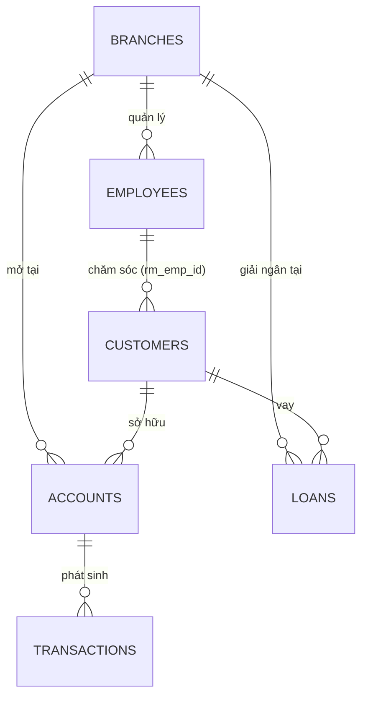

# Học phần 1: SQL for Beginner (8 Bài)

## Danh sách bài học
- [x] **Bài 1:** Tổng quan về CSDL, SQL, cài đặt tools thao tác với CSDL
- [ ] **Bài 2:** Câu lệnh truy vấn (`SELECT`, `WHERE`, `ORDER BY`, `DISTINCT`, `ALIAS`)
- [ ] **Bài 3:** Cấu trúc và thao tác dữ liệu (DDL: `CREATE`, `ALTER`, `DROP` | DML: `INSERT`, `UPDATE`, `DELETE`)
- [ ] **Bài 4:** Các hàm cơ bản (Xử lý số, chuỗi, ngày/tháng, chuyển đổi, hàm tổng hợp `SUM`, `AVG`, `MIN`, `MAX`, `COUNT`, `GROUP BY`, `HAVING`)
- [ ] **Bài 5:** SQL Join cơ bản (`INNER JOIN`, `LEFT JOIN`, `RIGHT JOIN`, `FULL JOIN`, `CROSS JOIN`)
- [ ] **Bài 6:** SQL Join nâng cao (Join `> 5-7 bảng` kết hợp các mệnh đề)
- [ ] **Bài 7:** Các chuyên đề khác (`Subquery`, `CTE / WITH`, tạo `VIEW`, bảng trung gian)
- [ ] **Bài 8:** Kết nối Power BI & Dự án tổng kết Học phần 1

## Sơ đồ quan hệ 6 bảng Ngân hàng (`inda_banking.db`)

## Cấu trúc file trong học phần này
- `schemas/01_init_banking_db.sql`: Script tạo 6 bảng và nạp dữ liệu mẫu.
- `lessons/01_bai1_2_select_where_orderby.sql`: Lý thuyết & câu lệnh mẫu Bài 1 & Bài 2.
- `exercises/01_bai1_2_exercises.sql`: 5 bài tập thực hành Bài 1 & Bài 2.
