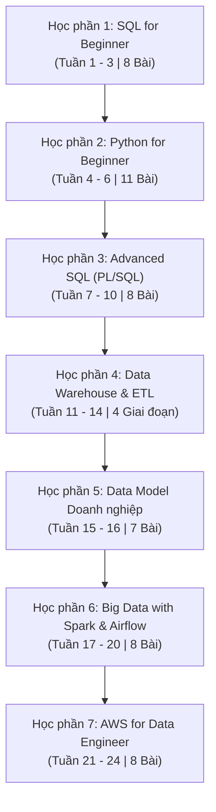

# Lộ Trình Chi Tiết 7 Học Phần Data Engineer (24 Tuần – Từ Zero Đến Apply Job)

Lộ trình này bám sát **100% cấu trúc 7 Học phần** của **INDA Academy** (120 giờ lý thuyết + 500 giờ thực hành dự án), được chia thành **24 tuần (6 tháng)** với lịch trình từng tuần, công cụ cần cài đặt và **5 dự án thực chiến (Portfolio Projects)** để bạn tự tin đi phỏng vấn.

---

## HỌC PHẦN 1: SQL for Beginner – Truy vấn & Thao tác dữ liệu (Tuần 1 – Tuần 3)
* **Thời lượng:** 3 tuần (~15 giờ lý thuyết + 45 giờ thực hành)
* **Công cụ cần cài:** Oracle Database (hoặc PostgreSQL/SQL Server), DBeaver / SQL Developer, Microsoft Power BI Desktop.

### Lịch trình từng tuần
* **Tuần 1 (Bài 1, 2, 3): Làm quen CSDL & Truy vấn cơ bản**
  - [ ] **Bài 1:** Tổng quan về RDBMS, SQL; cài đặt DBMS và công cụ truy vấn.
  - [ ] **Bài 2:** Truy vấn `SELECT`, lọc dữ liệu với `WHERE`, sắp xếp `ORDER BY`, loại trùng `DISTINCT`, đặt tên giả `ALIAS`.
  - [ ] **Bài 3:** Nhóm lệnh DDL (`CREATE`, `ALTER`, `DROP`, `TRUNCATE`) và DML (`INSERT`, `UPDATE`, `DELETE`).
* **Tuần 2 (Bài 4, 5, 6): Hàm xử lý & Kỹ thuật Join đa bảng**
  - [ ] **Bài 4:** Hàm xử lý số, chuỗi, ngày/tháng (`TO_CHAR`, `TO_DATE`, `EXTRACT`), hàm chuyển đổi (`CAST`, `COALESCE`/`NVL`), hàm tổng hợp (`SUM`, `AVG`, `MIN`, `MAX`, `COUNT` kết hợp `GROUP BY`, `HAVING`).
  - [ ] **Bài 5:** Nắm vững 5 loại Join: `INNER JOIN`, `LEFT JOIN`, `RIGHT JOIN`, `FULL OUTER JOIN`, `CROSS JOIN`.
  - [ ] **Bài 6:** Thực hành Join nâng cao nhiều bảng (**> 5–7 bảng** trong cùng 1 câu truy vấn) kết hợp điều kiện lọc và gom nhóm.
* **Tuần 3 (Bài 7, 8): Truy vấn nâng cao & Dự án cuối khóa HP1**
  - [ ] **Bài 7:** Truy vấn con (`Subquery` ở `SELECT`, `FROM`, `WHERE`), bảng tạm `CTE (WITH ... AS)`, tạo `VIEW` và sử dụng bảng trung gian (staging/temp tables) để tăng tốc độ đọc dữ liệu.
  - [ ] **Bài 8 (Mini-Project 1):** Kết nối trực tiếp CSDL với **Power BI**, viết các câu SQL tính toán KPI thực tế của doanh nghiệp (doanh thu, tăng trưởng, tỷ lệ giữ chân khách hàng) và dựng Dashboard tổng kết.

---

## HỌC PHẦN 2: Python for Beginner – Lập trình xử lý dữ liệu (Tuần 4 – Tuần 6)
* **Thời lượng:** 3 tuần (~15 giờ lý thuyết + 45 giờ thực hành)
* **Công cụ cần cài:** Python 3.10+, VS Code / PyCharm, Jupyter Notebook, thư viện `numpy`, `pandas`, `sqlalchemy`, `oracledb`/`psycopg2`.

### Lịch trình từng tuần
* **Tuần 4 (Bài 1, 2, 3, 4): Cú pháp & Cấu trúc dữ liệu cốt lõi**
  - [ ] **Bài 1 & 2:** Biến, kiểu dữ liệu, toán tử, biểu thức điều kiện (`if/elif/else`) và vòng lặp (`for`, `while`).
  - [ ] **Bài 3:** Xử lý chuỗi (`String` methods, formatting, regex cơ bản để làm sạch text).
  - [ ] **Bài 4:** Làm chủ 4 cấu trúc dữ liệu: `List`, `Tuple`, `Set`, `Dictionary` (và List/Dict Comprehension).
* **Tuần 5 (Bài 5, 6, 7, 8): Hàm, OOP, File, Quản lý lỗi & Kết nối CSDL**
  - [ ] **Bài 5:** Xây dựng hàm tự định nghĩa (`def`, `*args`, `**kwargs`, `lambda`).
  - [ ] **Bài 6:** Lập trình hướng đối tượng (Class, Object, kế thừa) và đọc/ghi File (`CSV`, `JSON`, `TXT`, `Excel`).
  - [ ] **Bài 7:** Tổ chức Module/Package và bắt lỗi chuẩn trong Data Pipeline (`try - except - finally`, `logging`).
  - [ ] **Bài 8:** Kết nối Python với Database: thực thi câu lệnh SQL, đọc dữ liệu theo lô (chunking) và nạp dữ liệu hàng loạt (bulk insert).
* **Tuần 6 (Bài 9, 10, 11): Xử lý dữ liệu với NumPy, Pandas & Tổng kết**
  - [ ] **Bài 9:** Thao tác mảng nhiều chiều và tính toán vector hóa với **NumPy**.
  - [ ] **Bài 10:** Quản lý và biến đổi dữ liệu bảng với **Pandas** (`DataFrame`, lọc, xử lý `NaN`/duplicates, `merge`, `groupby`, `pivot_table`).
  - [ ] **Bài 11 (Mini-Project 2):** Viết ứng dụng Python tự động đọc dữ liệu thô từ nhiều file CSV/JSON & API, làm sạch bằng Pandas và đẩy tự động vào CSDL đã tạo ở Học phần 1.

---

## HỌC PHẦN 3: Advanced SQL (for Data Engineer) – Lập trình dữ liệu nâng cao (Tuần 7 – Tuần 10)
* **Thời lượng:** 4 tuần (~20 giờ lý thuyết + 80 giờ thực hành)
* **Công cụ cần cài:** Oracle Database (Express Edition hoặc Docker image) & **Oracle SQL Developer**.

> [!NOTE]
> Đây là học phần tạo ra sự khác biệt giữa Data Analyst và Data Engineer (đặc biệt trong khối **Ngân hàng, Chứng khoán, Bảo hiểm**), giúp bạn xử lý hàng chục triệu dòng dữ liệu ngay trong Database.

### Lịch trình từng tuần
* **Tuần 7 (Bài 1, 2): Lập trình PL/SQL & Con trỏ (Cursor)**
  - [ ] **Bài 1:** Kiến trúc khối lệnh PL/SQL (`DECLARE - BEGIN - EXCEPTION - END`), thiết lập SQL Developer.
  - [ ] **Bài 2:** Rẽ nhánh `IF-THEN-ELSE`, `CASE`; các vòng lặp `LOOP`, `WHILE LOOP`, `FOR LOOP`; làm việc với **Con trỏ (`Explicit/Implicit Cursor`)** và kiểu dữ liệu cấu trúc phức tạp (`RECORD`, `COLLECTION`).
* **Tuần 8 (Bài 3, 4): Hàm phân tích nâng cao & Kiểm soát Transaction**
  - [ ] **Bài 3:** Lệnh `MERGE INTO` (Upsert dữ liệu cực kỳ quan trọng trong ETL); nhóm **Ranking Functions** (`ROW_NUMBER`, `RANK`, `DENSE_RANK`) và **Analytic/Window Functions** (`LAG`, `LEAD`, `FIRST_VALUE`, `SUM/AVG OVER(PARTITION BY ...)`).
  - [ ] **Bài 4:** Tạo và quản lý `Sequence`; kiểm soát tiến trình giao dịch **Transaction** (`COMMIT`, `ROLLBACK`, `SAVEPOINT`, xử lý Deadlock và đảm bảo tính toàn vẹn dữ liệu).
* **Tuần 9 (Bài 5, 6): Thủ tục, Hàm, Package & Trigger**
  - [ ] **Bài 5:** Lập trình `Stored Procedure` (tham số `IN`, `OUT`, `IN OUT`) và `Function` tái sử dụng để đóng gói luồng xử lý dữ liệu.
  - [ ] **Bài 6:** Tổ chức code quy mô lớn bằng `Package` (Specification & Body), sử dụng các Package có sẵn của Oracle (`DBMS_OUTPUT`, `DBMS_SCHEDULER`, `UTL_FILE`) và viết `Trigger` kiểm soát thay đổi dữ liệu.
* **Tuần 10 (Bài 7, 8): Tối ưu hiệu năng CSDL & Dự án thực chiến số 1**
  - [ ] **Bài 7:** Kỹ thuật tối ưu hóa câu lệnh SQL chạy nhanh gấp nhiều lần: đọc `Execution Plan`, đánh **Index** (B-Tree, Bitmap, Function-based Index) và chia nhỏ bảng lớn bằng **Partitioning** (Range, List, Hash Partition).
  - [ ] **Bài 8 (Dự án Thực chiến 1 – Core Banking SQL Engine):** Xây dựng bộ `Package` PL/SQL tổng hợp sao kê, tính lãi/phí và báo cáo rủi ro tín dụng trên bảng giao dịch hàng triệu bản ghi, áp dụng Partitioning & Indexing để tối ưu thời gian chạy từ hàng chục phút xuống vài giây.

---

## HỌC PHẦN 4: DataWarehouse – Xây dựng Kho dữ liệu & ETL (Tuần 11 – Tuần 14)
* **Thời lượng:** 4 tuần (~20 giờ lý thuyết + 100 giờ dự án)
* **Công cụ cần cài:** Oracle Database, **Oracle Data Integrator 12c (ODI 12c)**, Microsoft Power BI.

### Lịch trình từng tuần
* **Tuần 11: Kiến trúc Kho dữ liệu & Mô hình Dim – Fact**
  - [ ] Tổng quan kiến trúc Data Warehouse đa tầng: **Source → Staging → Core DWH → Data Mart → BI**.
  - [ ] Thiết kế **Star Schema / Snowflake Schema**: phân biệt các loại bảng `Dimension` và `Fact`, nắm vững cơ chế lưu lịch sử thay đổi dữ liệu **SCD Type 1, Type 2, Type 3** (trọng tâm **SCD Type 2**).
  - [ ] Cài đặt, cấu hình môi trường **Oracle Data Integrator 12c (ODI)** (Topology, Repositories, Agents).
* **Tuần 12: Giai đoạn 1 & Giai đoạn 2 của luồng ETL**
  - [ ] **Giai đoạn 1 (Source → Staging/Data Lake):** Phát triển các job ETL trích xuất dữ liệu từ nhiều nguồn khác nhau (CSDL nghiệp vụ, File phẳng, tích hợp qua **API**) đưa vào vùng tạm (`Staging`) và Data Lake.
  - [ ] **Giai đoạn 2 (Staging → DataWarehouse):** Xây dựng các Mapping/Procedure chuẩn hóa, kiểm tra chất lượng dữ liệu, xử lý SCD Type 2 và nạp vào tầng `Data Warehouse`.
* **Tuần 13: Giai đoạn 3 – Data Mart & Đa luồng (Parallel ETL)**
  - [ ] **Giai đoạn 3 (DataWarehouse → DataMart):** Xây dựng các bảng tổng hợp chuyên biệt cho từng phòng ban (Tài chính, Kinh doanh, Rủi ro).
  - [ ] **Giai đoạn 3 (tiếp):** Thiết kế Load Plan chạy **đa luồng, song song (parallel execution)** các job ETL, xử lý phụ thuộc và cơ chế chạy lại khi lỗi cho toàn doanh nghiệp.
* **Tuần 14: Giai đoạn 4 – Phát triển BI & Dự án thực chiến số 2**
  - [ ] **Giai đoạn 4:** Kết nối tầng Data Mart với **Microsoft Power BI**, xây dựng mô hình ngữ nghĩa và phát triển hệ thống báo cáo thông minh hỗ trợ ra quyết định.
  - [ ] **Dự án Thực chiến 2 (End-to-End Enterprise DWH):** Tự tay thiết kế và triển khai luồng ETL hoàn chỉnh từ hệ thống nguồn + API → Staging → DWH (có SCD Type 2) → Data Mart → Báo cáo Power BI.

---

## HỌC PHẦN 5: Data Model – Thiết kế Mô hình Dữ liệu trong Doanh nghiệp (Tuần 15 – Tuần 16)
* **Thời lượng:** 2 tuần (~12 giờ lý thuyết + 40 giờ dự án)
* **Công cụ cần cài:** Oracle SQL Developer Data Modeler (hoặc Erwin / Lucidchart / dbdiagram.io).

> [!TIP]
> Bạn có thể đọc trước **Bài 1–4 của Học phần 5** ngay ở **Tuần 11** khi bắt đầu học Data Warehouse để hiểu sâu hơn về thiết kế bảng, sau đó hoàn thiện toàn bộ dự án thiết kế kiến trúc dữ liệu doanh nghiệp ở Tuần 15–16.

### Lịch trình từng tuần
* **Tuần 15 (Bài 1, 2, 3, 4): Từ ERD đến Thiết kế Logic & Vật lý**
  - [ ] **Bài 1 & 2:** Tổng quan CSDL doanh nghiệp; khảo sát nghiệp vụ, thiết kế mô hình thực thể liên kết (**ERD**) và mô hình mô tả tiến trình.
  - [ ] **Bài 3:** Chuyển đổi mô hình ERD (Conceptual) thành **Thiết kế mức Logic (Logical Data Model)** – xác định thực thể, thuộc tính, quan hệ 1-1, 1-N, N-N.
  - [ ] **Bài 4:** Chuyển đổi thiết kế mức Logic thành **Thiết kế mức Vật lý (Physical Data Model)** – chi tiết hóa mức bảng, cột, kiểu dữ liệu, Primary Key, Foreign Key, Constraints, Index.
* **Tuần 16 (Bài 5, 6, 7): Chuẩn hóa CSDL & Dự án thực chiến số 3**
  - [ ] **Bài 5 & 6:** Áp dụng các dạng **Chuẩn hóa CSDL (Normalization: 1NF, 2NF, 3NF, BCNF)** cho hệ thống ứng dụng (Application OLTP) và kỹ thuật chuyển đổi sang mô hình Kho dữ liệu (DWH OLAP).
  - [ ] **Bài 7 (Dự án Thực chiến 3 – Enterprise Data Modeling):** Thiết kế trọn bộ hồ sơ Data Model (Conceptual → Logical → Physical + DDL Script) cho một hệ thống ứng dụng Ngân hàng / Thương mại điện tử và Kho dữ liệu đi kèm.

---

## HỌC PHẦN 6: Big Data with Spark – Dữ liệu lớn với Spark & Airflow (Tuần 17 – Tuần 20)
* **Thời lượng:** 4 tuần (~20 giờ lý thuyết + 95 giờ dự án)
* **Công cụ cần cài:** Docker & Docker Compose, Git, cụm **Apache Hadoop (HDFS, YARN)**, **Apache Spark (PySpark)**, **Apache Hive**, **Apache Airflow** (kèm làm quen **Apache Kafka**).

### Lịch trình từng tuần
* **Tuần 17 (Bài 1, 2, 3): Hệ sinh thái Big Data & Hadoop**
  - [ ] **Bài 1:** Bản chất Big Data (3V/5V), kiến trúc tiếp cận, xử lý và lưu trữ dữ liệu lớn hiện đại.
  - [ ] **Bài 2:** Kiến trúc tổng thể và thực hành làm việc với **Hadoop**: hệ thống file phân tán **HDFS**, quản lý tài nguyên **YARN**, mô hình xử lý **MapReduce**.
  - [ ] **Bài 3:** Quản trị môi trường Big Data, kiến trúc **Big Data Pipeline** và các phép biến đổi dữ liệu phân tán thường dùng.
* **Tuần 18 (Bài 4, 5): Xử lý dữ liệu lớn & ML với Apache Spark**
  - [ ] **Bài 4:** Kiến trúc **Apache Spark** (Driver, Executor, DAG Scheduler, RDD vs DataFrame), cài đặt và chạy ứng dụng Spark cơ bản.
  - [ ] **Bài 5:** Phát triển ứng dụng Big Data chuyên sâu với **PySpark / Spark SQL** (đọc/ghi Parquet/ORC, joins phân tán, partitioning, caching, tối ưu bộ nhớ) và áp dụng **Machine Learning (Spark MLlib)** trên tập dữ liệu lớn.
* **Tuần 19 (Bài 6, 7): Apache Hive & Điều phối tự động với Apache Airflow**
  - [ ] **Bài 6:** Kiến trúc và cách sử dụng hiệu quả **Apache Hive** (Hive Metastore, External/Managed Tables, Partitioning & Bucketing để truy vấn SQL trên Big Data).
  - [ ] **Bài 7:** Kiến trúc tổng thể của **Apache Airflow** (Webserver, Scheduler, Worker, DAGs, Operators); cài đặt Airflow trên Docker và lập trình các DAGs tự động hóa và giám sát toàn bộ pipeline.
* **Tuần 20 (Bài 8): Tổng kết & Dự án thực chiến số 4**
  - [ ] **Bài 8 (Dự án Thực chiến 4 – Big Data Pipeline với Hadoop, Spark, Hive & Airflow):** Xây dựng hệ thống Big Data Pipeline hoàn chỉnh trên Docker: thu thập dữ liệu quy mô lớn lưu xuống HDFS, dùng **Spark** xử lý & chạy mô hình phân tích/chấm điểm, tổ chức bảng truy vấn qua **Hive**, và lập lịch chạy tự động hàng ngày bằng **Airflow**.

---

## HỌC PHẦN 7: AWS for Data Engineer – Kỹ thuật Dữ liệu trên Đám mây (Tuần 21 – Tuần 24)
* **Thời lượng:** 4 tuần (~18 giờ lý thuyết + 95 giờ dự án)
* **Công cụ cần cài:** Tài khoản AWS (Free Tier + kiểm soát Billing Alert), AWS CLI, Boto3 (Python SDK).

### Lịch trình từng tuần
* **Tuần 21 (Bài 1, 2, 3): Hạ tầng AWS, IAM, EC2, S3 & Serverless Lambda**
  - [ ] **Bài 1:** Hạ tầng toàn cầu của AWS (Regions, Availability Zones), tạo tài khoản, cấu hình cảnh báo chi phí (Billing & Cost Management).
  - [ ] **Bài 2:** Quản trị định danh và phân quyền bảo mật với **AWS IAM** (Users, Groups, Roles, Policies); khởi tạo, kết nối SSH và vận hành máy chủ ảo **Amazon EC2**.
  - [ ] **Bài 3:** Xây dựng Data Lake trên **Amazon S3** (Buckets, Storage Classes, Lifecycle, Partitioning) và lập trình xử lý dữ liệu hướng sự kiện (Serverless) với **AWS Lambda**.
* **Tuần 22 (Bài 4, 5): Hệ thống Databases, Redshift & NoSQL trên AWS**
  - [ ] **Bài 4:** Tổng quan các dịch vụ Database trên AWS; khởi tạo, cấu hình bảo mật (Security Groups, VPC cơ bản) và kết nối CSDL quan hệ trên **Amazon RDS**.
  - [ ] **Bài 5:** Kiến trúc kho dữ liệu đám mây **Amazon Redshift** (Cluster, Node types, Distribution Styles, Sort Keys), nạp dữ liệu hàng loạt (`COPY` từ S3 vào Redshift); thực hành NoSQL với **Amazon DynamoDB** và **DocumentDB**.
* **Tuần 23 (Bài 6, 7): Đồng bộ dữ liệu (DMS), ETL & Điều phối (Glue, EMR, Step Functions)**
  - [ ] **Bài 6:** Kiến trúc **AWS DMS (Database Migration Service)** – thực hành kéo và đồng bộ dữ liệu (Full Load & CDC - Change Data Capture) giữa các hệ thống Databases lên S3/Redshift.
  - [ ] **Bài 7:** Làm chủ bộ công cụ Big Data & ETL trên AWS:
    - **AWS Glue:** Tự động dò schema với `Glue Crawler`, quản lý metadata tập trung trên `Glue Data Catalog`, viết job biến đổi dữ liệu với `Glue ETL` (Spark Serverless).
    - **Amazon EMR:** Triển khai cụm Spark/Hadoop quy mô lớn trên Cloud.
    - **AWS Step Functions:** Thiết kế luồng điều phối (Orchestration) kết hợp Lambda, Glue ETL và thông báo trạng thái.
* **Tuần 24 (Bài 8): Tổng kết & Dự án thực chiến số 5 (Capstone Project)**
  - [ ] **Bài 8 (Dự án Thực chiến 5 – Cloud Data Platform trên AWS):** Xây dựng kiến trúc dữ liệu đám mây khép kín: Đồng bộ dữ liệu từ **Amazon RDS** qua **AWS DMS** và **Lambda** về Data Lake **Amazon S3** → Dùng **Glue Crawler & Glue Data Catalog** đánh mục lục → Chạy **AWS Glue ETL / EMR (Spark)** làm sạch và biến đổi theo mô hình Star Schema → Nạp vào kho dữ liệu **Amazon Redshift** & **DynamoDB** → Điều phối tự động toàn bộ luồng bằng **AWS Step Functions**.

---

## Tổng Hợp 5 Dự Án Thực Chiến Đưa Vào CV (Chuẩn Đầu Ra 500 Giờ Dự Án)

Khi hoàn thành 24 tuần theo đúng 7 học phần trên, CV của bạn sẽ có trọn bộ **5 dự án thực tế** bao phủ mọi yêu cầu tuyển dụng Data Engineer hiện nay:

| STT | Tên Dự Án trong Portfolio | Học phần tương ứng | Công nghệ sử dụng |
| :-: | :--- | :--- | :--- |
| **1** | **Hệ thống Xử lý & Tối ưu Dữ liệu Giao dịch Ngân hàng (Core DB Engine)** | Học phần 1, 2, 3 | Oracle SQL, PL/SQL (`Package`, `Procedure`, `Cursor`, `Partition`, `Index`), Python (`Pandas`) |
| **2** | **Thiết kế Data Model Chuẩn Doanh nghiệp (OLTP & OLAP)** | Học phần 5 | ERD, Logical & Physical Data Model, 3NF Normalization, Star Schema |
| **3** | **Xây dựng Kho dữ liệu Doanh nghiệp & Luồng ETL Đa tầng (Enterprise DWH)** | Học phần 4 | Oracle ODI 12c, Staging → DWH (SCD Type 2) → Data Mart, REST API, Power BI |
| **4** | **Hệ thống Big Data Pipeline & Tự động hóa Điều phối** | Học phần 6 | Hadoop (`HDFS`, `YARN`), Apache Spark (`PySpark`, `MLlib`), Apache Hive, Apache Airflow, Docker |
| **5** | **Nền tảng Dữ liệu Đám mây (End-to-End Cloud Data Platform)** | Học phần 7 | AWS (`IAM`, `EC2`, `S3`, `Lambda`, `RDS`, `DMS`, `Glue`, `EMR`, `Redshift`, `DynamoDB`, `Step Functions`) |

---

## Gợi Ý Phân Bổ Thời Gian Học Trong Tuần

Để hoàn thành 120 giờ lý thuyết + 500 giờ thực hành trong 6 tháng (trung bình ~25 giờ/tuần), hoặc giãn ra 8–9 tháng nếu bạn đang đi làm full-time (12–15 giờ/tuần):
* **20% thời gian (5h/tuần):** Xem/đọc lý thuyết và ghi chú kiến trúc của bài học trong tuần.
* **50% thời gian (12h/tuần):** Gõ code thực hành trực tiếp từng lệnh SQL, Python, PL/SQL, Spark, cấu hình ODI/Airflow/AWS.
* **30% thời gian (8h/tuần):** Làm dự án thực chiến cuối mỗi học phần, đẩy toàn bộ code + sơ đồ kiến trúc lên **GitHub** để làm Portfolio ứng tuyển.
